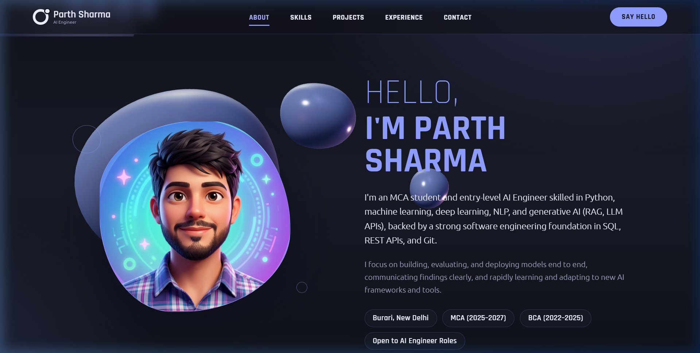

# Parth Sharma — AI Engineer Portfolio 🚀

[](https://threejs.org/)
[](https://greensock.com/gsap/)
[](https://developer.mozilla.org/en-US/docs/Web/JavaScript)
[](https://developer.mozilla.org/en-US/docs/Web/CSS)
[](https://developer.mozilla.org/en-US/docs/Web/HTML)

A modern, high-performance, interactive personal portfolio website designed for an **AI Engineer**. Built with a deep space aesthetic, periwinkle accents, WebGL 3D physics shaders, GSAP scroll triggers, and a modular architecture.

---

## 📸 Preview



---

## ✨ Key Features

- **Cinematic 3D Welcome Screen**:
  - Central morphing icosahedron with GPU vertex displacement shaders.
  - Dual counter-rotating wireframe shells with periwinkle holographic glow.
  - Galaxy of orbiting particle rings and floating polyhedra.
  - Minimalist aesthetic with subtle bottom progress bar and pulsing enter trigger.
  - Automatic GPU resource cleanup upon transitioning into the main site.

- **Interactive 3D Liquid Blob Engine**:
  - Real-time GPU-accelerated liquid physics simulation built with **Three.js**.
  - Custom vertex displacement GLSL shaders integrated into `MeshPhysicalMaterial`.
  - Camera and mesh deformation react dynamically to cursor movements and scroll velocity.
  - ACES Filmic tone mapping and dynamic studio lighting.

- **Rich Micro-Interactions & GSAP Animations**:
  - Staggered headline masks that slide smoothly into view via **GSAP ScrollTrigger**.
  - Interactive 3D tilt effect on project cards responding to pointer coordinates.
  - Infinite auto-scrolling skill marquees with pause-on-hover capability.
  - Dynamic typewriter effect showcasing engineering specializations.

- **Modular & Maintainable Codebase**:
  - Completely separated into `index.html`, `style.css`, and `script.js`.
  - Centralized **`PROFILE`** configuration object at the top of `script.js` for effortless resume updates.

- **Responsive & Accessible**:
  - Full mobile navigation drawer with backdrop blur.
  - Respects user motion preferences (`prefers-reduced-motion: reduce`).
  - Semantic HTML5 landmark structure and keyboard accessibility.

---

## 🛠️ Tech Stack

| Layer | Technology |
|---|---|
| **Structure** | Semantic HTML5 |
| **Styling** | Vanilla CSS3 (Custom properties, Glassmorphism, Keyframes, Flexbox & Grid) |
| **3D Graphics** | [Three.js](https://threejs.org/) (r128) |
| **Motion & Scroll** | [GSAP](https://greensock.com/gsap/) (3.12.5) & ScrollTrigger |
| **Typography** | Rajdhani & Ubuntu (Google Fonts) |

---

## 📁 Repository Structure

```plaintext
├── index.html       # Semantic HTML structure & CDN references (~195 lines)
├── style.css        # Modular stylesheet with categorized design tokens (~430 lines)
├── script.js        # Profile configuration, 3D WebGL scenes, & GSAP animations
├── image.png        # Profile avatar photo
├── preview.png      # High-definition portfolio screenshot
├── .gitignore       # Git exclusion rules (ignores local resume and temp files)
└── README.md        # Project documentation
```

---

## 🚀 Quick Start (Run Locally)

You can run this project locally without any complex build steps or dependencies:

### Using Python:
```bash
# Clone the repository
git clone https://github.com/parthashamrma/My-Portfolio.git
cd My-Portfolio

# Start a local HTTP server
python -m http.server 5174
```
Then visit **`http://localhost:5174/`** in your browser.

### Using VS Code Live Server:
1. Open the project folder in VS Code.
2. Right-click `index.html` and click **"Open with Live Server"**.

---

## ⚙️ Customization Guide

All personal data, projects, skills, and links are decoupled from the HTML markup and managed inside [`script.js`](script.js):

1. **Update Resume & Profile Details**:
   Edit the `PROFILE` object at the top of `script.js`:
   ```javascript
   const PROFILE = {
     name: 'Parth Sharma',
     roles: ['AI Engineer', 'Machine Learning Builder', 'Generative AI Developer'],
     links: {
       email: 'mailto:your-email@example.com',
       phone: 'tel:+91XXXXXXXXXX',
       github: 'https://github.com/your-username',
       linkedin: 'https://linkedin.com/in/your-username'
     },
     skills: { row1: [...], row2: [...] },
     projects: [ ... ],
     timeline: [ ... ],
     certs: [ ... ]
   };
   ```

2. **Change Theme Colors**:
   Modify the CSS custom properties in [`style.css`](style.css):
   ```css
   :root {
     --ink: #10121a;        /* Background deep space */
     --peri: #8f9eff;       /* Primary periwinkle glow */
     --peri-soft: #aab4ff;  /* Accent soft periwinkle */
     --peri-deep: #5f6fe0;  /* Secondary gradient shade */
   }
   ```

---

## 👤 Author

**Parth Sharma**
- Role: AI Engineer (MCA Student)
- Location: New Delhi, India
- LinkedIn: [linkedin.com/in/parth-sharma-37666a2aa](https://linkedin.com/in/parth-sharma-37666a2aa)
- Email: [ps4689203@gmail.com](mailto:ps4689203@gmail.com)
